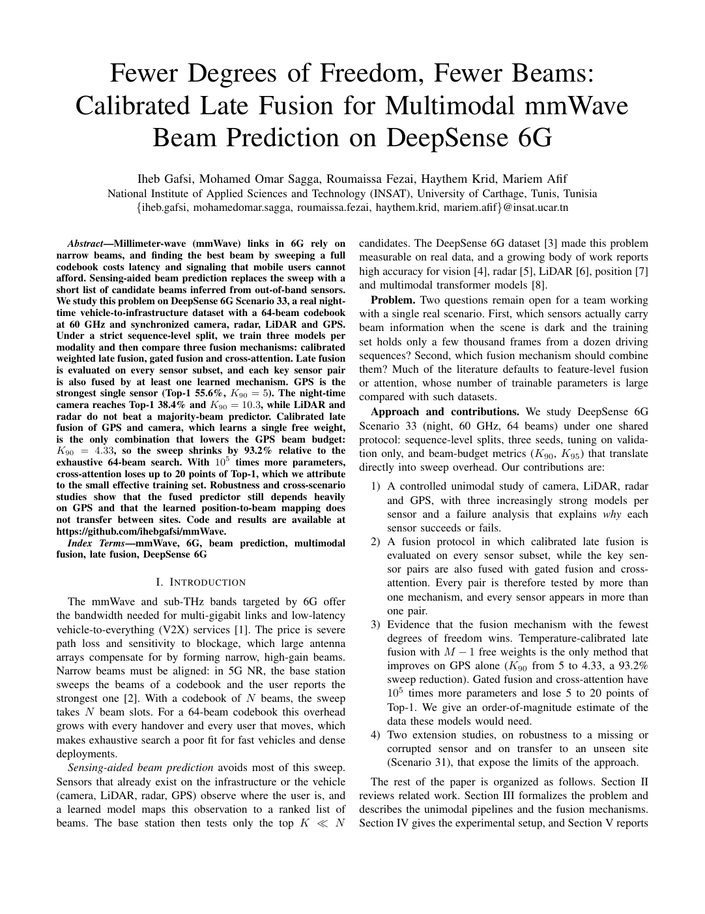

# DeepSense 6G Scenario 33: Multimodal mmWave Beam Prediction

Research code and experiment record for predicting a useful 60 GHz mmWave beam from vehicle sensors, with the goal of reducing the number of beams that must be tested compared with an exhaustive 64-beam sweep.

<p align="center">
  <a href="manuscript/paper.pdf"></a>
  <a href="presentation/MmWave.pdf"></a>
  <a href="https://github.com/ihebgafsi/mmWave"></a>
  <a href="https://www.kaggle.com/datasets/haythemkrid/deepsense6g-catalog"></a>
</p>

**Authors:** Iheb Gafsi, Omar Sagga, Roumaissa Fezai, Haythem Krid, and Mariem Afif  
**Affiliation:** National Institute of Applied Sciences and Technology (INSAT), University of Carthage

<p align="center">
  <a href="manuscript/paper.pdf"></a>
  <a href="presentation/MmWave.pdf"></a>
</p>
<p align="center"><sub>Paper and presentation covers — click either preview to open the full PDF.</sub></p>

> **Headline result (from the manuscript):** GPS is the strongest single modality (Top-1 55.6%, K90 = 5). Calibrated late fusion of GPS and camera reduces K90 to 4.33, corresponding to an estimated 93.2% fewer beams than an exhaustive 64-beam sweep. Sweep reduction is a beam-count estimate, not measured latency.

## How to read this repository

1. **Start with the [paper](manuscript/paper.pdf)** for the research question, related work, experiments, results, and limitations; use the [presentation](presentation/MmWave.pdf) for a short visual overview.
2. **Check the shared protocol** in [`docs/00_GENERAL.md`](docs/00_GENERAL.md), then [`common/`](common/) for the actual data, split, and metric implementations.
3. **Explore experiments** in the [notebook index](#experiment-notebook-index). The notebooks hold the detailed model and analysis work; they are not all packaged as standalone training scripts.
4. **Reproduce data preparation** with the [cache instructions](#reproducing-the-shared-data-pipeline). Raw data and large generated artifacts are external.
5. **Use the [references](#references)** to follow the beam-prediction and multimodal-fusion literature.

## Research question

Can camera, radar, LiDAR, and GPS measurements predict the best beam reliably enough to reduce beam-search overhead? We evaluate each modality independently and compare multimodal fusion methods, with particular attention to whether fusion improves on the strong location-based GPS baseline.

The main comparative thread is **late fusion**: combine per-modality beam scores and evaluate modality subsets under a shared data split and metric protocol. Feature concatenation, gated fusion, and cross-attention are additional learned-fusion approaches represented in the experiment notebooks. They are alternatives to compare, not assumed improvements.

## Dataset and task

The experiments use **DeepSense 6G scenario 33**, with 3,981 indexed samples across 18 sequences. Each example is labeled with `unit1_beam`, a class from 1 to 64 (63 classes occur in this scenario). The model predicts scores for all 64 beams.

| Modality | Model input | Representation |
|---|---:|---|
| Camera | `(3, 224, 400)` | RGB crop, normalized for ImageNet |
| Radar | `(4, 256, 250)` | Range-Doppler representation |
| Radar RA | `(1, 256, 64)` | Range-angle representation |
| LiDAR BEV | `(3, 128, 128)` | Bird's-eye view: point density, maximum height, and mean height |
| LiDAR points | `(4096, 3)` | Sampled 3D points |
| GPS | `(5,)` | Relative `x`, `y`, distance, and sine/cosine of bearing |

These are the tensors returned by the shared loader; preprocessing and normalizing statistics are implemented in [`common/`](common/).

## Evaluation protocol

- **Sequence-level splits:** all frames in a sequence stay in one split to reduce near-duplicate leakage. The committed split is [`splits/splits.json`](splits/splits.json).
- **Shared data path:** experiments use the same dataset, split, label, and evaluation helpers in `common/`.
- **Model selection:** tune on validation data; reserve the test split for final evaluation. The planned final protocol uses seeds 0, 1, and 2, reporting mean and standard deviation.
- **Top-K accuracy:** the fraction of samples whose true beam appears among the model's top `K` scores. We report Top-1, Top-3, and Top-5.
- **K90 / K95:** the smallest fixed number of beams needed for aggregate Top-K accuracy to reach at least 90% / 95%.
- **Sweep overhead and gain:** `overhead = K / 64`; `gain = 1 - K / 64`. These are proportional beam-search estimates, **not measured end-to-end latency**.

The evaluation helpers and definitions live in [`common/metrics.py`](common/metrics.py). Results can be aggregated across the seed records present in the results directory:

```bash
python -m common.aggregate
```

This writes `results/summary.csv`. Optional power-loss metrics are also supported when power measurements are supplied.

## Repository guide

| Path | Contents |
|---|---|
| [`common/`](common/) | Shared configuration, cache builder, dataset/loaders, sequence splits, metrics, sanity checks, and result aggregation |
| [`splits/`](splits/) | Committed sample and sequence assignments |
| [`notebooks/`](notebooks/) | Exploratory analysis and camera, radar, LiDAR, GPS, late-fusion, ablation, and attention-fusion experiments |
| [`docs/`](docs/) | General protocol and modality-specific contributor notes |
| [`manuscript/`](manuscript/) | Paper manuscript |
| [`presentation/`](presentation/) | Project presentation |

The notebooks contain the detailed experiment code, analyses, and any outputs saved with them. Large datasets, generated caches, checkpoints, embeddings, and result files are not tracked here; see [shared experiment artifacts](https://drive.google.com/drive/folders/1m_6KqQr4QVNpg3bj_Tn9IkFqKOc8MPbM).

### Experiment notebook index

| Notebook | Focus |
|---|---|
| [`exploratory data analysis (optionnel).ipynb`](<notebooks/exploratory data analysis (optionnel).ipynb>) | Dataset structure, sensor inspection, and exploratory analysis |
| [`camera+late-fusion+ablation+bonus.ipynb`](notebooks/camera+late-fusion+ablation+bonus.ipynb) | Camera experiments, late fusion, ablations, and extensions |
| [`radar.ipynb`](notebooks/radar.ipynb) | Radar representations, baselines, and model experiments |
| [`LiDAR.ipynb`](notebooks/LiDAR.ipynb) | LiDAR experiments |
| [`gps-modality.ipynb`](notebooks/gps-modality.ipynb) | GPS features and beam prediction |
| [`attention-fusion.ipynb`](notebooks/attention-fusion.ipynb) | Cross-attention fusion experiments |

## Reproducing the shared data pipeline

The raw DeepSense data is not included in this repository. On Kaggle, attach the scenario-33 data and either clone/upload this repository or use a published shared cache. The [DeepSense 6G catalog](https://www.kaggle.com/datasets/haythemkrid/deepsense6g-catalog) provides dataset access.

### Build the cache

Set paths **before importing `common`**. `DS6G_ROOT` must point to the directory containing `scenario33_dev.csv` and the referenced sensor files. `DS6G_WORK` is where the generated `master.csv` and `cache/` will be stored.

```python
import os

os.environ["DS6G_ROOT"] = "/kaggle/input/<scenario-33-data>/scenario33"
os.environ["DS6G_WORK"] = "/kaggle/working/ds6g"
os.environ["DS6G_RESULTS"] = "/kaggle/working/project/results"
```

```bash
pip install plyfile tqdm
python -m common.build_cache --stage all
python -m common.sanity
```

The cache build uses `open3d` for PLY files when available, or `plyfile` otherwise. The `all` stage processes every modality and may take substantial time and storage. To prepare only the shared metadata and split first, run `python -m common.build_cache --stage meta`; individual cache stages are `camera`, `radar`, `radar_ra`, `lidar`, and `lidar_pts`.

### Use a published cache

If `master.csv` and `cache/` are available in an attached Kaggle dataset, point `DS6G_WORK` at that dataset instead. Set the variable before importing `common`:

```python
import os
os.environ["DS6G_WORK"] = "/kaggle/input/<shared-cache>"
```

Then run `python -m common.sanity`. Missing modality cache files are reported by modality so the relevant build stage can be run.

## Using the shared loader and evaluator

Training code should use the common loaders so that experiments share the same rows, labels, and split:

```python
from common.dataset import get_loaders
from common.metrics import evaluate, save_results, seed_everything

seed_everything(0)
train_loader, val_loader, test_loader = get_loaders(["gps"], batch_size=32)

# Train a model on train_loader and select its checkpoint using val_loader.
# Its forward pass should return one score per beam: (batch_size, 64).
metrics, test_logits = evaluate(model, test_loader, keys=["gps"])
save_results(
    "GPS-E1",
    seed=0,
    metrics=metrics,
    config={"modalities": ["gps"]},
    test_logits=test_logits,
)
```

For fusion, `get_loaders` accepts multiple modality keys. Validation and test loaders do not shuffle, keeping predictions aligned for late-fusion experiments. The loader also supports temporal `history`/`horizon`, modality dropout, and modality-specific transforms for controlled extensions.

## Research notes and limitations

- Scenario 33 contains 18 sequences, so sequence-level evaluation is important and the sample size remains limited.
- The camera frames in this scenario are night-time imagery; the dataset does not support a day-versus-night comparison.
- The CSV beam label is retained as the target even when it differs from the maximum-power beam in the supplied power vector.
- The reported sweep gain is inferred from the number of beams evaluated. This repository does not measure radio signaling latency or end-to-end deployment performance.
- Fusion results should be compared against GPS as well as unimodal vision/radar/LiDAR results; adding a modality does not by itself establish an improvement.

For the full shared protocol and per-modality experiment guidance, see [`docs/00_GENERAL.md`](docs/00_GENERAL.md) and the modality notes in [`docs/`](docs/).

## References

- Gafsi, I., Sagga, O., Fezai, R., Krid, H., and Afif, M. **“Fewer Degrees of Freedom, Fewer Beams: Calibrated Late Fusion for Multimodal mmWave Beam Prediction on DeepSense 6G.”** See the [project manuscript](manuscript/paper.pdf) and [official implementation](https://github.com/ihebgafsi/mmWave).
- Va, V., Choi, J., and Heath, R. W. **“Inverse Multipath Fingerprinting for Millimeter Wave V2I Beam Alignment.”** [Paper (U.S. DOT repository)](https://rosap.ntl.bts.gov/view/dot/32606/dot_32606_DS1.pdf).
- Rezaie, A., et al. **“Location- and Orientation-Aided Millimeter Wave Beam Selection Using Deep Learning.”** [IEEE ICC, 2020](https://doi.org/10.1109/ICC40277.2020.9149272).
- Morais, J., Behboodi, A., Pezeshki, H., and Alkhateeb, A. **“Position-Aided Beam Prediction in the Real World: How Useful GPS Locations Actually are?”** [IEEE ICC, 2023](https://doi.org/10.1109/ICC45041.2023.10278998).
- Alkhateeb, A., et al. **DeepSense 6G dataset and scenario resources.** [Dataset catalog](https://www.kaggle.com/datasets/haythemkrid/deepsense6g-catalog). Additional vision, radar, LiDAR, and fusion references are listed in the [manuscript bibliography](manuscript/paper.pdf).
